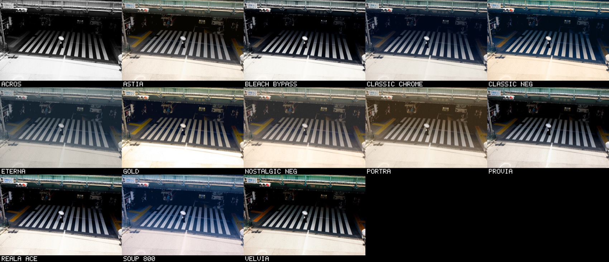

<div align="center">

# 🎞️ Soup Engine for the Canon EOS 50D <sub><sup>beta</sup></sub>

### Film looks, in the camera, on a Canon EOS 50D.

`beta` &nbsp;·&nbsp; `GPL v2` &nbsp;·&nbsp; `13 film stocks` &nbsp;·&nbsp; `EOS 50D` &nbsp;·&nbsp; `firmware 1.0.9`

A community port by [@rebelt2i](https://github.com/rebelt2i).
<br>[← All cameras](../README.md#-pick-your-camera)

### 📦 [Download Canon-EOS-50D.zip](https://github.com/jiijii0/soup-engine/releases/download/folders/Canon-EOS-50D.zip)

</div>

<br>

Turn **Film** on in Magic Lantern's menu and pick a stock. Every photo
you take after that gets a second JPEG beside the raw, with the look
already on it.

```
IMG_1234.CR2        your raw file, untouched
FLM_1234.JPG        the same photo with the look on it
```



> ⚠️ **Beta.** Unofficial code on your camera. Raws are never modified
> unless you turn on **Delete CR2** yourself.

> ⚖️ **No warranty.** Like all GPL software this comes with none. You
> install it at your own risk. See sections 11 and 12 of the
> [licence](LICENSE).

> 🎨 **The looks are still being tweaked.** The names are shorthand for
> the films they're based on, not exact copies. All trademarks belong
> to their owners.

<br>

---

<br>

## 📦 Installing

You need a **Canon EOS 50D on firmware 1.0.9** and a CompactFlash card.

On the 50D, Soup Engine is built into Magic Lantern itself. There is no
`SE.BIN`. You build a Magic Lantern `autoexec.bin` that has the Film
page in it.

### 1️⃣ &nbsp; Install Magic Lantern

> ### 👉 [builds.magiclantern.fm/50D.html](https://builds.magiclantern.fm/50D.html)

Follow their instructions, then check the camera starts and their menu
opens before going further. Back up their `autoexec.bin`, because
putting it back is how you uninstall.

### 2️⃣ &nbsp; Download and build it

> ### 📦 [Download Canon-EOS-50D.zip](https://github.com/jiijii0/soup-engine/releases/download/folders/Canon-EOS-50D.zip)

There are no prebuilt files for the 50D yet, so you build them from the
folder.

You need `arm-none-eabi-gcc` and Python 3. From this folder:

```sh
cd src
python3 tools/build-50d.py                      # build only
python3 tools/build-50d.py --card /path/to/card  # build and copy to the card
```

The script checks out Magic Lantern at a pinned commit (`ed3e7c0d`,
their 2025-06-20 50D build), adds the Film page from
[`integrations/magiclantern/50D.109/`](integrations/magiclantern/50D.109),
and builds it. Nothing of Magic Lantern's is committed here.

### 3️⃣ &nbsp; Put it on the card

`--card` does this for you. By hand, the two built files are in
`src/vendor/magiclantern/platform/50D.109/build/`:

| file | where it goes on the card |
|:--|:--|
| 📄 `autoexec.bin` | `AUTOEXEC.BIN`, replacing Magic Lantern's |
| 🧭 `50D_109.sym` | `ML/modules/50D_109.sym`, **always together with the `AUTOEXEC.BIN` above** |
| 🎞️ `src/stocks/*.fs` and `INDEX.TXT` | `ML/FILM/` |

The build details, and the pitfalls found along the way, are in
[`src/README.md`](src/README.md) and
[`src/ml/platforms/50D.109/PITFALLS.md`](src/ml/platforms/50D.109/PITFALLS.md).

<br>

---

<br>

## 📷 Using it

Open Magic Lantern's menu and go to the **Film** tab.

| setting | what it does |
|:--|:--|
| **Film** | `ON` develops every new raw. `OFF` leaves every file alone. |
| **Delete CR2** | after `FLM_nnnn.JPG` is written, removes the raw. Off by default. |
| **Stock** | the look to develop with, from `ML/FILM` |

Your choices are saved to `ML/SE.CFG` and survive switching the camera
off.

<br>

## 🧹 Removing it

Put Magic Lantern's original `autoexec.bin` back on the card. That's all.

<br>

---

<br>

## ❤️ Thanks

Ported by [@rebelt2i](https://github.com/rebelt2i). The engine and the
film stocks are [Soup Engine](../README.md) by
[@jiijii0](https://github.com/jiijii0).

This runs inside [Magic Lantern](https://magiclantern.fm). Soup Engine
isn't their project, so please don't take problems with it to them.
Open an issue on this repo instead, and say it's the 50D.

## 📄 Licence

GPL v2. See [LICENSE](LICENSE).
