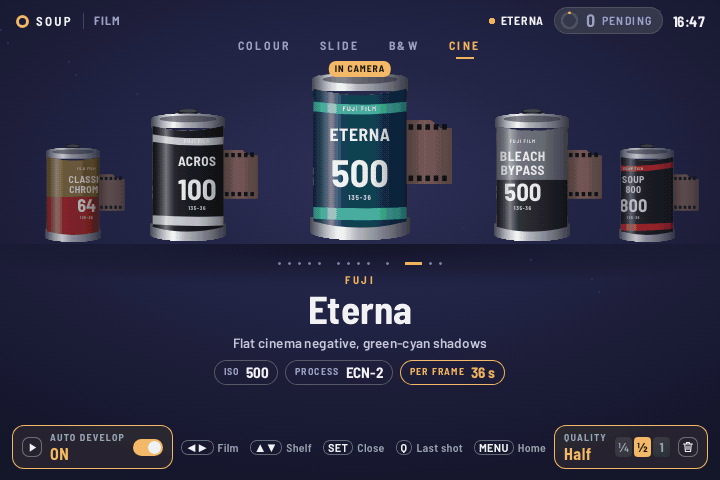
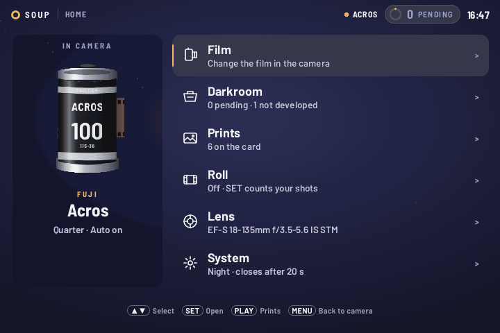
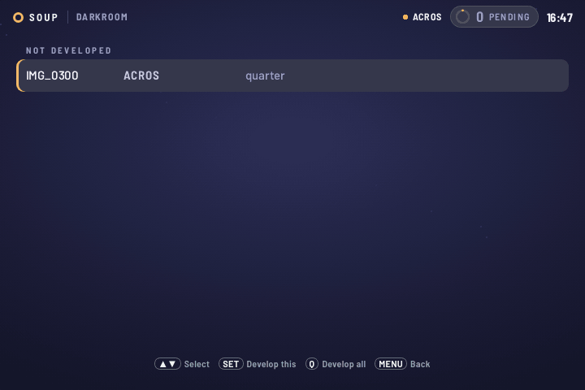
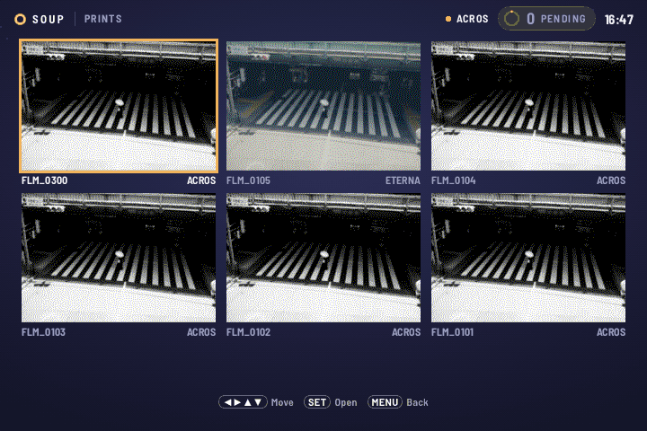
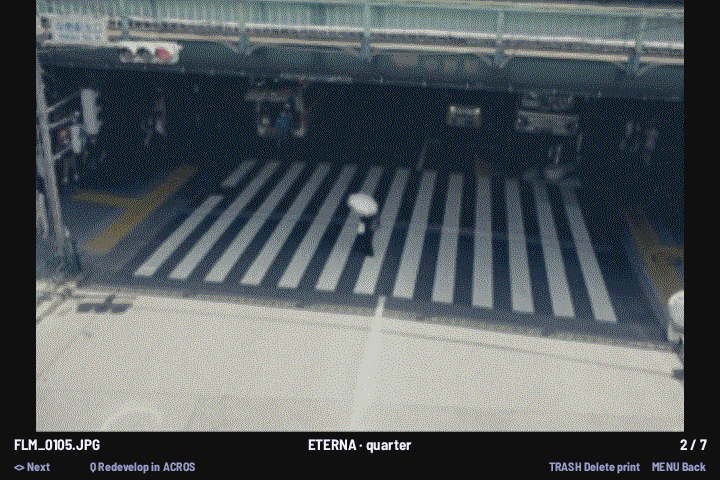
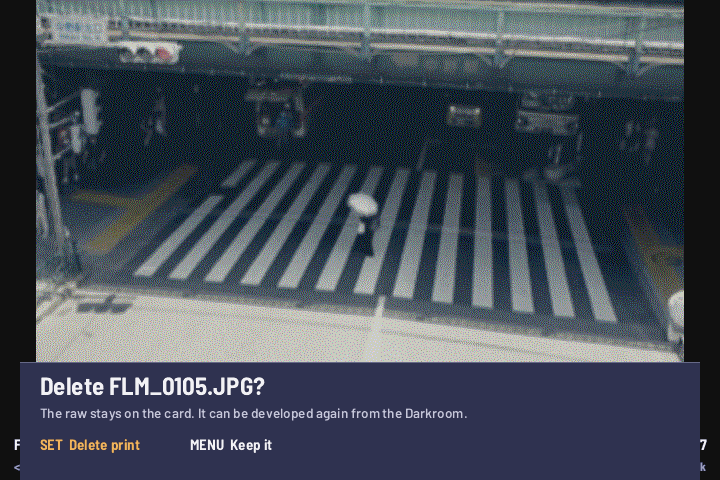
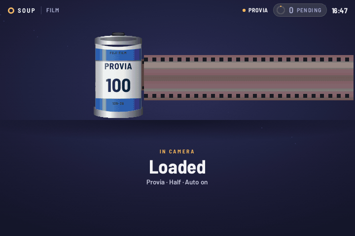
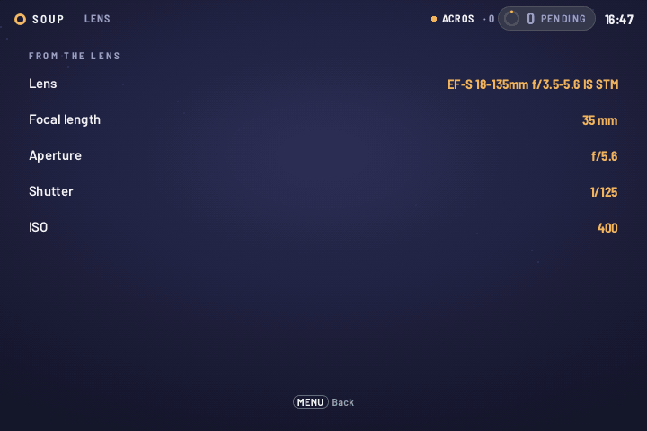
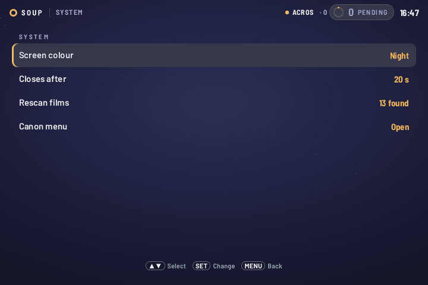

<div align="center">

# 🎞️ Soup Engine for the Canon EOS 700D <sub><sup>beta</sup></sub>

### Film looks, in the camera, on a Canon EOS 700D / Rebel T5i / Kiss X7i.

`beta` &nbsp;·&nbsp; `GPL v2` &nbsp;·&nbsp; `13 film stocks` &nbsp;·&nbsp; `EOS 700D / Rebel T5i / Kiss X7i` &nbsp;·&nbsp; `firmware 1.1.5`

A community port by [@GitariDev](https://github.com/GitariDev).
<br>[← All cameras](../README.md#-pick-your-camera)

</div>

<br>

Pick a film on the back screen: **INFO** opens a shelf of film cans.
Every photo you take after that gets a second JPEG saved beside the raw,
with the look already on it.

```
IMG_1234.CR2        your raw file, untouched
FLM_1234.JPG        the same photo with the look on it (the filesystem is 8.3)
```

Your raw files are never modified. Delete the JPEG and the photo is
exactly as the camera shot it.

> ⚠️ **Beta.** Unofficial code on your camera. It's easy to remove, and it
> never modifies your raw files.

> ⚖️ **No warranty.** Like all GPL software this comes with none. You
> install it at your own risk. See sections 11 and 12 of the
> [licence](LICENSE).

> 🎨 **The looks are still being tweaked** and will keep changing. The
> names are shorthand for the films they're based on, not exact copies.
> All trademarks belong to their owners, and none of them has anything to
> do with this project.

<br>

---

<br>

## 📷 About this port

This build is for the **EOS 700D** on firmware 1.1.5. It's an
ordinary Magic Lantern module rather than a patched binary. You keep
Magic Lantern's whole menu. The film screen, Home, Darkroom, Prints, Roll,
Lens and System all run on the camera.



<sub>This and the other screens here are the real module drawing through the
real palette, in the simulator (`tools/sim700d`), not photos of a camera. The
clock and the lens are the simulator's, and the pictures come from
`doc/stocks.jpg`.</sub>

### Installing

1. Install Magic Lantern's 700D build for firmware 1.1.5 from
   [builds.magiclantern.fm](https://builds.magiclantern.fm/), and check the
   camera starts and their menu opens. The module is built against their
   2025-06-20 build (`ed3e7c0df`). A much newer or older build may refuse to
   load it.
2. Download the zip from the
   [latest 700D release](https://github.com/GitariDev/soup-engine/releases/latest)
   on GitariDev's fork,
   or build it with `make card-700d` (see [`src/README.md`](src/README.md)).
3. Unzip it to the root of the card, merging into the `ML` folder that is
   already there.
4. Eject the card properly and switch the camera on.

| file | what it is |
|:--|:--|
| ⚙️ `ML/modules/soupeng.mo` | the module |
| ✅ `ML/SETTINGS/soupeng.en` | an empty file that tells Magic Lantern to load it |
| 🎞️ `ML/FILM/*.fs` | the film stocks |
| 🖼️ `ML/DATA/SOUPUI.BIN` | the art for the screens. Without it INFO opens a plain list of the films |

The module makes `ML/PRINTS` itself, and logs to `ML/LOGS/SOUPENG.LOG`.

To remove it, delete `soupeng.mo` and `soupeng.en`. Your raws and prints stay
on the card, and Magic Lantern carries on as before.

> 🆘 **Always eject the card from the computer before pulling it.** A card
> pulled without ejecting has left the camera unable to start with it, until
> it was ejected cleanly. On a Mac, copy with `COPYFILE_DISABLE=1 cp`, or run
> `dot_clean`, or the `._` files turn up in the camera's folder listings.

### How it fits with Magic Lantern

Open Magic Lantern's menu as usual: on this body the **Trash** button, in
shooting mode. **Shoot > Soup Engine** is where the module lives, with Film,
Auto develop, Develop last shot, Size and Rescan films. Everything else in
Magic Lantern's menu is untouched. The current film is shown at the bottom
right of the shooting screen, with a red `ML BRACKET ON` above it if Advanced
Bracket is on in the same Shoot menu, because that turns every shutter press
into a sequence.

The film screen below is Soup Engine's own, and needs no menu at all.

### The film screen

Press **INFO** in shooting mode. The film screen is the first stop of Canon's
INFO cycle.

| button | what it does |
|:--|:--|
| ◀️ ▶️ or the dial | choose a film (the dial has not been confirmed on a camera yet) |
| 🔼 🔽 | jump between shelves |
| ✅ **`SET`** | load the film |
| ▶️ **`PLAY`** | Auto develop on or off, bottom left |
| 🗑️ **Trash** | Quality: Quarter, Half or Full, bottom right |
| **`Q`** | develop the last shot |
| **`MENU`** | Home |
| **`INFO`** | on to Canon's next screen |
| half-press | closes it, and the shutter still fires: a picture is never lost to a menu |

AE lock (star) and AF point stay Canon's. They appear to send one unnamed event
with nothing to tell them apart, so they could not be used here. Outside this
screen SET and the rest are left to Canon, and it keeps out of Canon's menu, the
Q screen and the other settings screens. It closes by itself after 20 seconds,
which System can change.

Shoot with auto off, judge on the back screen, and develop only the frames
that deserve it.

### Home and its pages

**MENU** on the film screen opens Home. Up and down move, `SET` opens, `MENU`
goes back a step, and Trash closes. `PLAY` on Home opens Prints.

| | |
|:--|:--|
|  |  |
| **Home.** What is in the camera, and the way to everything else. | **Darkroom.** Frames developing and raws with no print. `SET` develops one, `Q` all of them. |
|  |  |
| **Prints.** What is on the card, six to a page. `SET` opens one. | **The viewer.** Left and right flip, `Q` redevelops it in the film in the camera. |
|  |  |
| **Trash in the viewer** deletes the print, after asking. The raw stays. | **Loaded.** What `SET` shows on the film screen. |
|  |  |
| **Lens.** What the lens is reporting. | **System.** Screen colour, how soon it closes, rescan the films, and Canon's menu. |

**Roll** counts your shots. It has no size, and a new film starts a new one.

### Sizes and speed

Every shot gets `FLM_1234.JPG` beside its raw while Auto develop is on.

| Quality | Pixels | A frame takes |
|:--|:--|:--|
| Quarter | 1296x864 | about 10 seconds |
| Half | 2592x1728 | about 40 seconds |
| Full | 5184x3456 | about three minutes |

Keep shooting while it works. Frames queue, each keeps the film and size it was
shot with, the count at the top of the screen says how many wait, and the
camera will not switch itself off with frames pending. If the power goes
mid-frame, that frame is picked up again at the next start.

### Known limits

- **Prints are a preview, not a print.** They are 648x432 in 180 colours,
  because they share the bitmap layer with the menus. They are good for
  judging a frame, not a grade, and Canon's own playback looks cleaner. The
  dither was changed from a fixed pattern to error diffusion to lose the
  cross-hatch (see [the R&D notes](doc/menu-sample/RND.md#the-dither)), and that
  change has passed the simulator but has not run on a camera yet. Canon's
  full-colour layer needs play mode, which this module has never run in, so it
  isn't used. Previews already on a card are made again the first time each is
  opened.
- **No `SOURCE: RAW`.** Developing from the sensor data needs the whole decoded
  frame, 37 MB on this body, and Magic Lantern cannot hand that out in one
  piece there. The 5D's answer was to spool it through the card at minutes a
  frame, which is not worth having. The JPEG Canon embeds in each raw is the
  path every frame takes.
- **The dial** moves films in the code, but has not been confirmed on a camera.
- **Touch** does nothing on these screens. Magic Lantern reports that a finger
  touched, not where.
- **Whether `FLM_` files show in Canon's PLAY** has not been settled. Prints is
  the way to see them on the camera.

<br>

<br>

---

<br>

## 🎞️ The films

Thirteen, still under development.

They're small text files in `ML/FILM` on the card, so you can read them,
change them, or write your own.

<br>

<div align="center">

### 🎨 [Soup Stocks](https://jiijii0.github.io/soup-stocks/)

**A web editor for the film stocks.**

Drop in a photo, move sliders, download a `.fs`, put it on the card.

The preview is this engine's own code compiled to WebAssembly, so it
matches what the camera writes.<br>Your photo never leaves your browser.

</div>

<br>

---

<br>

---

<br>

## ❤️ Thanks

**Soup Engine** is the work of **luigi manga**
([jiijii0](https://github.com/jiijii0/soup-engine)): the look, the film stocks,
the engine and the 5D Classic build are theirs. The 700D port is by
[GitariDev](https://github.com/GitariDev/soup-engine), written with an AI assistant (Claude), as the commits say.

This wouldn't exist without [Magic Lantern](https://magiclantern.fm).

Soup Engine runs inside their work. Their builds are what let these cameras run
any of this, and years of their reverse engineering made it possible to
understand. They're worth supporting.

The UX and UI of the 700D's menu are inspired by
[**M-Film**](https://github.com/HNGSeries/M-Film), by
[**@hng.spl**](https://www.instagram.com/hng.spl). The layout follows the menu
shown in their video. None of their code was seen or used.

Soup Engine isn't Magic Lantern's project, so please don't take problems with
it to them. Open an issue here instead.

<br>

<br>

## 📄 Source and licence

All of it is in [`src/`](src); the module itself is in
[`src/ml/700d/`](src/ml/700d). Nothing of Magic Lantern's is committed
here: `make card-700d` fetches their source at a pinned commit.

GPL v2. See [LICENSE](LICENSE). Distributed **without any warranty**,
including the implied warranties of merchantability and fitness for a
particular purpose (sections 11 and 12).

The 700D's screens use the Barlow typeface, by The Barlow Project Authors,
under the SIL Open Font License 1.1. It is embedded in
[`doc/menu-sample/index.html`](doc/menu-sample/index.html) and its glyphs are
rendered into `SOUPUI.BIN`; the licence is
[`doc/menu-sample/OFL-Barlow.txt`](doc/menu-sample/OFL-Barlow.txt).

Film names, and the brand names on the cans, are shorthand for the films the
looks are based on. They belong to their owners.
