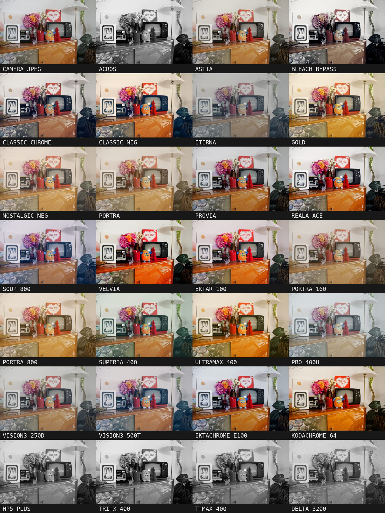
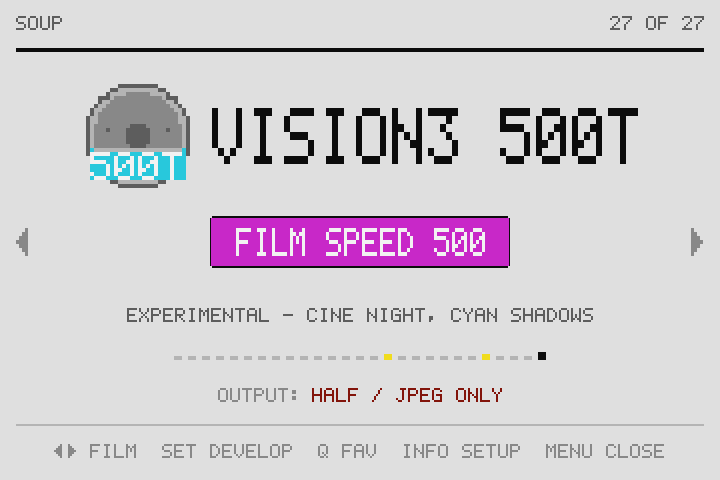
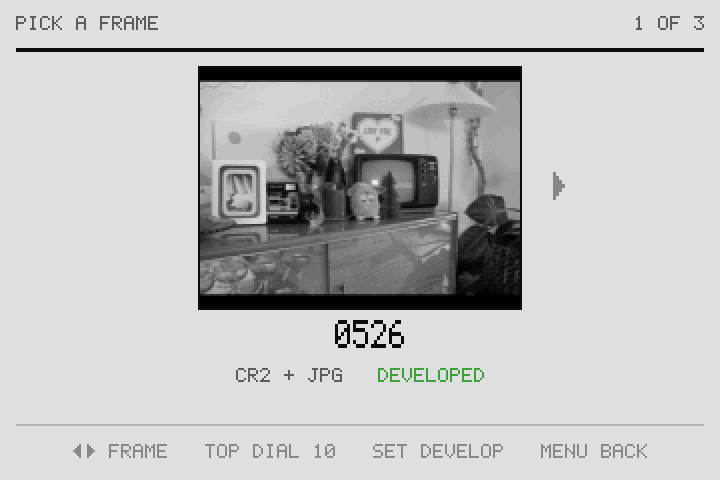
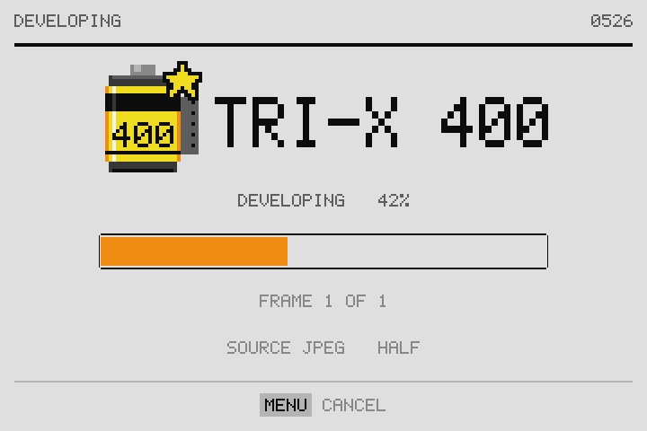

# Souper7D

Film looks developed inside the original Canon EOS 7D. Souper7D is a
[Magic Lantern](https://www.magiclantern.fm/) module that runs your photos
through 27 film stocks on the camera itself: pick a film, press SET, and a
developed JPEG lands on the card.

It is a port of [Soup Engine](https://github.com/jiijii0/soup-engine) by
jiijii0 (written for the 5D) to the original 7D, with its own interface,
batch developing and a faster engine.



<p>



</p>

> **This is a beta.** It's unofficial code on a 2009 camera, it only runs on
> the exact setup below, and it can delete files (see output modes). Try it on
> a card you don't mind wiping first. Like all GPL software it comes with no
> warranty: you install it at your own risk (sections 11 and 12 of the
> [licence](LICENSE)).

The film names are shorthand for the stocks the looks are based on, not exact
copies. All trademarks belong to their owners. Stocks marked EXPERIMENTAL are
new in this port and still being tuned.

## What you need

- An original EOS 7D (not the Mark II) on Canon firmware 2.0.3.
- Magic Lantern `lua_fix.2020Dec28.7D203` already installed and working
  ([builds.magiclantern.fm/7D.html](https://builds.magiclantern.fm/7D.html),
  install guide on the ML wiki). Other ML builds are untested: the module only
  uses symbols exported by that build.
- A CF card. RAW+S (RAW plus the small JPEG) is the fastest way to shoot for it.

## Install

1. Download the release zip and copy its `ML` folder onto the card, merging
   with the `ML` folder already there. It adds `ML/modules/soup7d.mo` and
   `ML/FILM/` (the 27 stocks and `INDEX.TXT`). Nothing else on the card changes.
2. In the camera, open the ML menu → **Modules**, enable **soup7d**, restart.
3. The first boot after adding the module may show Err 70. Turn the camera
   off and on once: it's Canon's file catalogue rebuilding, not the module.

To remove it, delete `ML/modules/soup7d.mo` (and `ML/FILM`, `ML/SOUP` if you like).

## Use

Press **Picture Style** (or open the **Film** tab in the ML menu) to get the film screen.

| Button | On the film screen |
| --- | --- |
| Dial / joystick | Change film |
| **SET** | Develop menu |
| **Q** | Mark the film as a favourite (favourites come first) |
| **INFO** | Settings: size, output mode, auto develop |
| **MENU** or half-press | Close |

The develop menu offers **PICK** (browse frames with a thumbnail), **LATEST**,
**ALL NEW** (everything since the last frame you developed) and **LAST N**.
A half-press cancels a develop; a cancelled frame is left untouched.

Size is HALF (2592 px wide) or FULL (5184 px, about four times as long).

The output mode decides what happens to the camera's files:

| Mode | What happens |
| --- | --- |
| JPEG ONLY (default) | The developed JPEG replaces the camera's JPEG under the same name, and the RAW is **deleted** (only after the new file is checked). One finished picture per frame. |
| REPLACE JPEG | The developed JPEG replaces the camera's JPEG; the RAW is kept. Playback still shows the RAW's preview. |
| NEW JPEG | A new file next to the originals, under the next free number. Originals kept. |
| NEW JPEG + DELETE RAW | As NEW JPEG, then deletes the RAW if a full-size camera JPEG is kept. |
| ML/SOUP FOLDER | New file in `ML/SOUP/`. Originals kept. |

Auto develop (off by default) develops each new shot a couple of seconds
after you stop shooting, with the current film.

Developed files carry `SOUP ENGINE - <film> #<frame>` in the EXIF Software tag,
and are never developed twice: a frame can only be developed again from its RAW.

### Speed

About 17 s a frame at HALF from RAW+S with Live View off (T-MAX 400; colour
stocks with halation and grain take a little longer, up to ~23 s). Live View on
roughly doubles it. The engine has no FPU or hardware divide to lean on, so it
is all integer code.

### Things the camera does that you should know

- New files show up in playback after a restart. Canon only lists files it
  wrote itself or found at power-on. JPEG ONLY frames show their developed
  picture after you turn the camera off and on.
- Playback of a RAW+JPEG pair shows the RAW's embedded preview, so a developed
  JPEG next to its RAW looks undeveloped in playback. JPEG ONLY avoids this.
- If Canon later reuses a file number the module took, the module renames its
  own file at the next scan. Camera files are never renamed.
- `ML/SOUP/FIND.TXT` logs the last develop job and `ML/SOUP/DIAG.TXT` any
  stock or memory problems. Useful in bug reports.

## The stocks

Colour: Astia, Classic Chrome, Classic Neg, Ektachrome E100\*, Ektar 100\*,
Eterna, Gold, Kodachrome 64\*, Nostalgic Neg, Portra, Portra 160\*, Portra 800\*,
Pro 400H\*, Provia, Reala Ace, Soup 800, Superia 400\*, Ultramax 400\*, Velvia,
Vision3 250D\*, Vision3 500T\*, Bleach Bypass.
Black and white: Acros, Delta 3200\*, HP5 Plus\*, T-MAX 400\*, Tri-X 400\*.

\* new in this port (EXPERIMENTAL). The rest come from Soup Engine.

Stocks are plain-text `.fs` files in `ML/FILM/` (curves, per-hue saturation,
split toning, grain, halation). File names must be 8.3 (`portr160.fs`, not
`portra160.fs`): Canon's file system opens nothing longer. To add one, drop the
file in and add its name to `INDEX.TXT`.

## Building

You need `arm-none-eabi-gcc` (tested with 16.2) and the Magic Lantern source
at changeset `7e5067c0a8cf`, the one `lua_fix.2020Dec28.7D203` was built
from. Only its headers are used.

```bash
cd port-7d
make ML=/path/to/magic-lantern     # path without spaces
```

`soup7d.c` is generated from `port-7d/parts/` (edit the parts, not soup7d.c):

```bash
cd port-7d/parts && cat head.c part_frames.c part_meta.c part_job.c part_gui.c tail.c > ../soup7d.c
```

Before putting a build on a camera, check that every symbol in
`build/imports.txt` is exported by the ML build's `7D_203.sym`, that
`arm-none-eabi-readelf -r` shows only `R_ARM_ABS32` / `R_ARM_CALL` /
`R_ARM_JUMP24`, and that `strings build/soup7d.mo | grep -c '%c'` is 0 (Canon's
`snprintf` mangles `%c`). `python3 resident.py build/soup7d.mo` prints the
resident size; it is ~119 KB and growing it much risks Err 70.

### Tests

Host tests run the module's real file-handling code against a fake ML API
(`port-7d/tests/mlstub/`). They need your own 7D files (not included): a folder
with a RAW+JPEG L pair.

```bash
cd port-7d/tests; E=../../src/engine
gcc -std=gnu99 -O1 -fsanitize=address,undefined numbering-regression.c -o /tmp/nr && /tmp/nr
gcc -std=gnu99 -O1 -fsanitize=address,undefined -w -Imlstub -I$E inplace-regression.c $E/se.c $E/cr2.c $E/jpeg_dec.c $E/jpeg_enc.c $E/look.c $E/stock.c $E/wb.c $E/color.c $E/grade.c $E/lut.c -lm -o /tmp/ir && /tmp/ir /path/to/7d-files "$PWD/../card/ML/FILM"
```

`batch-regression.c` and `streamcheck.c` take the same sample folder.
`tests/speed/refrun.sh` hashes every stock's output for byte-exact checks of
engine changes, and `tests/speed/arm/` is an ARM instruction-count profiler
(Unicorn) for measuring speed changes off the camera.

## Credits and licence

Soup Engine is by [jiijii0](https://github.com/jiijii0/soup-engine): the engine,
its decoder and encoder, the stock format and the original 13 stocks are theirs.
This port adds the 7D module, interface, batch and in-place developing, 14
stocks and the speed work. Built on [Magic Lantern](https://www.magiclantern.fm/).

GPL v2, see [LICENSE](LICENSE).
