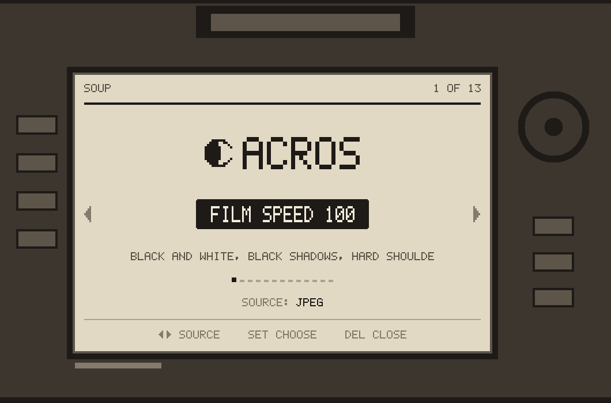
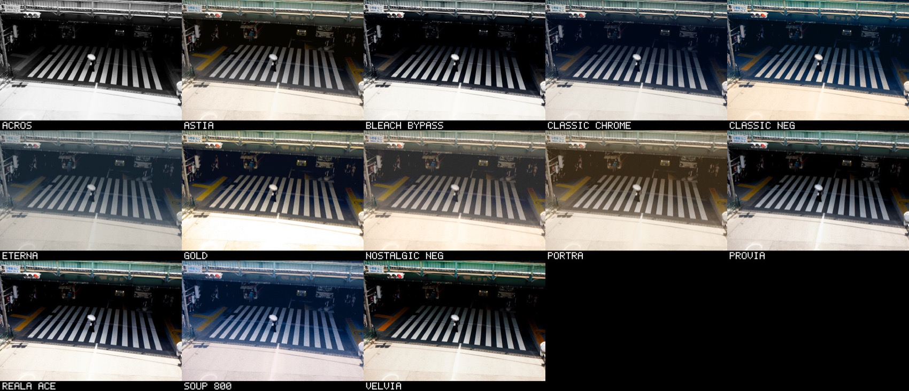

<div align="center">

# 🎞️ Soup Engine <sub><sup>beta</sup></sub>

### Film looks, in the camera, on old Canon DSLRs.

<br>



<br>
<br>

`beta` &nbsp;·&nbsp; `GPL v2` &nbsp;·&nbsp; `5 cameras` &nbsp;·&nbsp; `Magic Lantern`

</div>

<br>

Pick a film stock on the back screen. Every photo you take after that
gets a second JPEG saved beside the raw, with the look already on it,
developed by the camera itself.

```
IMG_1234.CR2        your raw file, untouched
IMG_1234.FLM.JPG    the same photo with the look on it
```

Your raw files are never modified. Delete the JPEG and the photo is
exactly as the camera shot it.

<sub>File names and options differ a little between cameras. Each
camera's README has the details.</sub>

<br>



<div align="center"><sub>
The original thirteen, one frame, straight off the card.
</sub></div>

<br>

---

<br>

## 📷 Pick your camera

Soup Engine started on the 5D Classic. The community has since ported
it to other bodies. Each camera has its own folder with everything it
needs: the source, the card files, and a README with the install steps
for that body.

**Click your camera** to open its folder. Its page has the photos, the
instructions, and the download for that camera.

<br>

| | camera | firmware | by |
|:--|:--|:--|:--|
| 📷 | **[Canon EOS 5D Classic](Canon-EOS-5D)** | 1.1.1 | [@jiijii0](https://github.com/jiijii0) |
| 🎞️ | **[Canon EOS 5D Classic, Half Frame](Canon-EOS-5D-Half-Frame)** | 1.1.1 | [@mmarco25](https://github.com/mmarco25) |
| 📷 | **[Canon EOS 7D](Canon-EOS-7D)** (original, not Mark II) | 2.0.3 | [@thebakers-club](https://github.com/thebakers-club) |
| 📷 | **[Canon EOS 50D](Canon-EOS-50D)** | 1.0.9 | [@rebelt2i](https://github.com/rebelt2i) |
| 📷 | **[Canon EOS 60D](Canon-EOS-60D)** | 1.1.1 | [@kookueh](https://github.com/kookueh) |
| 📷 | **[Canon EOS 700D / Rebel T5i / Kiss X7i](Canon-EOS-700D-Rebel-T5i)** | 1.1.5 | [@GitariDev](https://github.com/GitariDev) |
| 📷 | **[Canon EOS 6D](Canon-EOS-6D)** (original, not Mark II) | 1.1.6 | [@lbrock3](https://github.com/lbrock3) |

<br>

> ⚠️ **Use the folder for your exact camera and firmware.** The
> camera-side code is built against one body's firmware and one Magic
> Lantern build. Files from one folder will not work on another camera.

<br>

---

<br>

## 🍲 How it works

Every port shares the same idea and the same engine:

- **It runs inside [Magic Lantern](https://magiclantern.fm).** You
  install Magic Lantern for your camera first, then add Soup Engine to
  the card.
- **The engine is plain C, integer only.** It does the look, the film
  stock format, the CR2 reader and the JPEG codec. The same files build
  for the camera and for the desktop, so the desktop tools can check the
  camera's output byte for byte.
- **The films are small text files.** They live in `ML/FILM` on the card
  as `.fs` files, so you can read them, change them, or write your own.
- **It develops from the JPEG the camera already made** by default, which
  takes seconds rather than minutes. The raw stays untouched.

Each port has its own copy of the engine, tuned for that body (the 7D
has no FPU, the 700D needs 8.3 file names, and so on). A change in one
folder never affects another camera.

<br>

> ⚠️ **Beta.** This is unofficial code on cameras that are well over ten
> years old. It's easy to remove, and it never modifies your raw files.

> ⚖️ **No warranty.** Like all GPL software this comes with none. You
> install it at your own risk. See sections 11 and 12 of the
> [licence](LICENSE).

> 🎨 **The looks are still being tweaked** and will keep changing. The
> names are shorthand for the films they're based on, not exact copies.
> All trademarks belong to their owners.

<br>

---

<br>

## 🎨 Tools for the films

<div align="center">

### [Soup Stocks](https://jiijii0.github.io/soup-stocks/)

**A web editor for the film stocks.**

Drop in a photo, move sliders, download a `.fs`, put it on the card.

The preview is this engine's own code compiled to WebAssembly, so it
matches what the camera writes.<br>Your photo never leaves your browser.

<br>

### [SoupDesk](https://github.com/thebakers-club/SoupDesk)

**The same film stocks on your Mac**, for raws and JPEGs on the desktop.
<br>By [@thebakers-club](https://github.com/thebakers-club).

</div>

<br>

---

<br>

## 🛠️ Porting to another camera

Ports are welcome. Add a new folder named after the camera, for example
`Canon-EOS-40D/`, with everything that body needs inside it: the
source, the card files if there are any, and a `README.md` covering
what you need, how to install, how to use it, and how to remove it.
Then add a row to the table above and open a pull request.

Each folder gets its own download zip automatically. Link to it from
your README as
`https://github.com/jiijii0/soup-engine/releases/download/folders/<folder>.zip`.

Please keep changes inside your folder, so every camera's build stays
exactly as its author tested it.

<br>

---

<br>

## ❤️ Thanks

To everyone who ported it:
[@rebelt2i](https://github.com/rebelt2i) (50D),
[@GitariDev](https://github.com/GitariDev) (700D),
[@thebakers-club](https://github.com/thebakers-club) (7D) and
[@mmarco25](https://github.com/mmarco25) (5D half frame).

None of this would exist without [Magic Lantern](https://magiclantern.fm).
Soup Engine runs inside their work. Their builds are what let these
cameras run any of this, and years of their reverse engineering made it
possible to understand. They're worth supporting.

Soup Engine isn't their project, so please don't take problems with it
to them. Open an issue here instead, and say which camera you're using.

<br>

## 📄 Licence

GPL v2. See [LICENSE](LICENSE). Each camera folder carries its own copy.
Distributed **without any warranty**, including the implied warranties
of merchantability and fitness for a particular purpose (sections 11
and 12).
